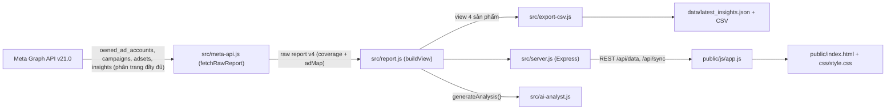

# PROJECT CONTEXT — Meta Ads Analytics (BM Ucmas Việt Nam)

> **Tài liệu bối cảnh dành cho AI / Developer tiếp theo.**
> Đọc file này TRƯỚC khi sửa bất kỳ dòng code nào. Quy tắc làm việc bắt buộc nằm ở
> [`.agents/rules/quy-tac-du-an.md`](./.agents/rules/quy-tac-du-an.md).
>
> Cập nhật lần cuối: 2026-10-16

---

## 1. Mục tiêu ứng dụng

Ứng dụng web **chạy local** (Node.js + Express + HTML/CSS/JS thuần) giúp chủ doanh nghiệp:

1. Kéo dữ liệu quảng cáo **thật** từ Meta Marketing API (Graph API) cho **toàn bộ tài khoản quảng cáo thuộc 1 Business Manager duy nhất**.
2. Xem báo cáo theo **2 chiều**: theo **Tài khoản quảng cáo** và theo **Sản phẩm**.
3. Theo dõi **ngân sách dự kiến chi tiêu trong ngày** (CBO + ABO) và tiến độ giải ngân hôm nay.
4. Nhận chẩn đoán / khuyến nghị tự động (rule-based, không gọi LLM) cho từng chiến dịch.
5. Xuất dữ liệu ra CSV / JSON chuẩn UTF-8.

Mô hình kinh doanh: **giáo dục (toán tư duy cho trẻ em)**. Chuyển đổi chính là **tin nhắn (messaging)** / lead, **KHÔNG phải mua hàng online**. Vì vậy CPA (giá/tin nhắn) là chỉ số quan trọng nhất; Doanh thu & ROAS thương mại điện tử không áp dụng.

---

## 2. Ràng buộc nghiệp vụ CỐ ĐỊNH (không được tự ý thay đổi)

| # | Ràng buộc | Giá trị |
|---|-----------|---------|
| 1 | Business Manager duy nhất | **BM ID `2590933284556026`** ("Ucmas Việt Nam"). System User hiện tại truy cập được **9/10** tài khoản (thiếu TK 7 `act_878031747567840`) |
| 2 | Meta App | App ID `1512128683054595` ("APP Test") |
| 3 | Sản phẩm được hiển thị & phân tích | **Chỉ 4 sản phẩm: UCMAS, UCKID, MATHCA, TRẠI HÈ** |
| 4 | Quy tắc nhận diện sản phẩm | Lấy đoạn text **giữa dấu `/` thứ 1 và thứ 2** trong tên chiến dịch. VD: `hai/ucmas/mess/khaigiang` → `ucmas` |
| 5 | Sản phẩm khác | Gán key `khac`, **không hiển thị** trong 4 thẻ sản phẩm và bộ lọc "Tất cả 4 sản phẩm" |
| 6 | Tiền tệ | VND, timezone `Asia/Ho_Chi_Minh` |

### 2.1 Bảng ánh xạ sản phẩm (`detectProduct()` trong `src/meta-api.js`)

| Đoạn giữa `/…/` (không phân biệt hoa thường) | key | Nhãn |
|---|---|---|
| chứa `ucmas` (gồm `ucmass`) | `ucmas` | UCMAS |
| chứa `uckid` hoặc bằng `uc-kid` | `uckid` | UCKID |
| chứa `mathca` (gồm `somathca`) | `mathca` | MATHCA |
| chứa `traihe` hoặc `trại hè` | `traihe` | TRẠI HÈ |
| còn lại | `khac` | Khác |

Fallback: nếu tên không có đủ dấu `/`, tìm từ khoá trong toàn bộ tên.

### 2.2 Công thức Ngân sách dự kiến hôm nay (`expectedDailyBudget`)

Phần lớn chiến dịch trong BM chạy **ABO** (ngân sách đặt ở Nhóm quảng cáo), nên `campaign.daily_budget` thường = 0.

```
Nếu chiến dịch đang chạy:
    Nếu campaign.daily_budget > 0  (CBO) → dùng campaign.daily_budget
    Ngược lại (ABO)                      → Σ adset.daily_budget của các adset có effective_status === 'ACTIVE'
Nếu chiến dịch không chạy → 0
```

⚠️ **Bắt buộc dùng `effective_status === 'ACTIVE'`** cho adset (không dùng `status`). Adset có `status: ACTIVE` nhưng chiến dịch cha bị tắt sẽ có `effective_status: CAMPAIGN_PAUSED` và KHÔNG tiêu tiền.

Tổng hợp lên: chiến dịch → sản phẩm (`products[i].expectedDailyBudget`) → toàn bộ (`summary.expectedDailyBudget`).

### 2.3 Chỉ số chuyển đổi chính (`extractConversions()`)

Trả về **hai trường tách biệt**, không gộp:

| Trường | Lấy từ action_type |
|---|---|
| `messages` | `onsite_conversion.messaging_conversation_started_7d`, dự phòng `onsite_conversion.total_messaging_connection` |
| `otherConversions` | `lead` / `onsite_conversion.lead` / `purchase` / `omni_purchase` |

⚠️ **CPA chỉ tính trên `messages`.** Trước 16/10/2026 hàm này gộp cả bốn loại vào một số
(`messages || connections || leads || purchases`), khiến chiến dịch 0 tin nhắn nhưng có
50 đơn hàng bị báo thành "50 tin nhắn" — CPA của các chiến dịch đo những thứ khác nhau
mà vẫn cộng chung.

---

## 3. Kiến trúc & luồng dữ liệu



1. Server khởi động → đọc `data/latest_insights.json` (schema v2-v4) vào bộ nhớ (`rawReport`).
2. Người dùng bấm **Đồng bộ** → `POST /api/sync` → `planSync()` quyết định kéo toàn bộ hay chỉ phần mới → `fetchRawReport()` gọi Meta API (chia theo tháng, phân trang đầy đủ) → gộp với kho cũ → ghi JSON/CSV → trả payload view + phân tích.
3. Lọc theo **sản phẩm / tài khoản / khoảng thời gian** đều xử lý 100% local qua `GET /api/data` — `buildView()` cắt lát kho dữ liệu trong ~4ms, KHÔNG gọi lại Meta API.

---

## 4. Cấu trúc thư mục

```text
Local_phantich_ads/
├── .agents/
│   ├── rules/quy-tac-du-an.md        # QUY TẮC BẮT BUỘC cho AI (always_on)
│   └── plugins/meta-ads/             # Plugin Antigravity: MCP server + skill meta-ads
│       ├── plugin.json
│       ├── mcp_config.json           # Trỏ tới mcp-launcher.js
│       └── skills/meta-ads/SKILL.md
├── data/                             # Dữ liệu sinh tự động (gitignored)
│   ├── latest_insights.json          # Snapshot raw report v4 (adMap + coverage)
│   ├── campaigns.csv                 # Excel UTF-8 BOM
│   └── daily_performance.csv
├── public/                           # Frontend tĩnh (served by Express)
│   ├── index.html                    # Layout dashboard chuẩn SEO & responsive
│   ├── css/style.css                 # Design system Dark Glassmorphism dùng CSS variables
│   └── js/app.js                     # Logic UI, Chart.js, bộ lọc & sắp xếp bảng
├── src/
│   ├── config.js                     # Đọc .env & updateEnvFile an toàn
│   ├── meta-api.js                   # Client Graph API với phân trang toàn diện
│   ├── report.js                     # View builder lọc 4 sản phẩm & tổng hợp chỉ số
│   ├── ai-analyst.js                 # Động cơ chẩn đoán rule-based chuẩn CPA tin nhắn
│   ├── export-csv.js                 # Xuất CSV UTF-8 BOM & JSON
│   └── server.js                     # Express server + REST API (chỉ loopback + token CSRF)
├── mcp-launcher.js                   # Khởi chạy @mikusnuz/meta-ads-mcp
├── .env                              # BÍ MẬT: token, app secret (gitignored)
├── .env.example                      # Mẫu biến môi trường
├── HUONG_DAN_LAY_TOKEN_META.md       # Hướng dẫn lấy access token
├── PROJECT_CONTEXT.md                # (file này)
└── README.md                         # Hướng dẫn sử dụng cho người dùng
```

---

## 5. Biến môi trường (`.env`)

| Biến | Bắt buộc | Mô tả |
|---|---|---|
| `META_ADS_ACCESS_TOKEN` | ✅ | User/System User token, quyền `ads_read`, `read_insights` |
| `META_AD_ACCOUNT_ID` | ⛔ (dùng cho MCP) | Tài khoản mặc định cho MCP server |
| `META_BUSINESS_ID` | ⛔ | Mặc định `2590933284556026` |
| `META_APP_ID` / `META_APP_SECRET` | ⛔ | Không dùng để lấy dữ liệu. Để trống được nếu dùng System User token hạn Never |
| `META_API_VERSION` | ⛔ | Mặc định `v21.0` |
| `PORT` | ⛔ | Mặc định `3000` |
| `SYNC_START_DATE` | ⛔ | Mốc bắt đầu kho dữ liệu, mặc định `2026-01-01` |
| `SYNC_RETRO_DAYS` | ⛔ | Số ngày luôn kéo lại mỗi lần đồng bộ, mặc định `7` |
| `ALLOW_REMOTE` | ⛔ | `true` mới cho máy khác trong LAN truy cập. Mặc định `false` |

---

## 6. REST API (`src/server.js`)

| Method | Endpoint | Chức năng |
|---|---|---|
| GET | `/api/data?product=...` | Trả về view báo cáo theo sản phẩm (`ALL` hoặc key sản phẩm) + phân tích AI |
| POST | `/api/sync` | Body `{ datePreset, accountId, productFilter }` → kéo dữ liệu mới từ Meta |
| POST | `/api/save-config` | Lưu token/app vào `.env` (chỉ cập nhật đúng key được gửi) |
| GET | `/api/session` | Trả token phiên (CSRF) cho trang cùng origin |
| POST | `/api/sync-sheet` | Chỉ làm mới lead Google Sheet (~0,3s, không gọi Meta) |
| GET | `/api/export/campaigns` \| `/daily` \| `/json` | Xuất CSV / JSON theo bộ lọc hiện tại |
| GET | `/docs/huong-dan-token` | Tải tài liệu hướng dẫn lấy token dạng text UTF-8 |

> Không có route `/auth/*` — ứng dụng không dùng OAuth, chỉ dán token thủ công.

**Bảo mật:** không gửi header CORS; chỉ nhận kết nối loopback (trừ khi `ALLOW_REMOTE=true`);
mọi route **ghi** đòi header `X-Internal-Token` lấy từ `GET /api/session`.

`datePreset` hợp lệ (hằng `DATE_PRESETS` trong `src/report.js`):
`today`, `yesterday`, `last_7d`, `last_14d`, `last_30d`, `last_90d`,
`this_month`, `last_month`, `this_quarter`, `this_year`.

---

## 7. Cấu trúc view báo cáo trả về cho Client

```jsonc
{
  "view": {
    "fetchedAt": "ISO date",
    "datePreset": "last_30d",
    "scope": { "businessId", "accountId", "name", "currency" },
    "bmAccounts": [ { "id", "numericId", "name", "status", "currency" } ],
    "product": "ALL | ucmas | uckid | mathca | traihe",
    "products": [
      { "key", "name", "subtitle", "count", "spend", "messages", "expectedDailyBudget", "todaySpend", "todayMessages", "cpa", "ctr", "cpc", "pacingPct" }
    ],
    "summary": {
      "totalSpend", "totalMessages", "avgCpa", "expectedDailyBudget", "todaySpend", "todayMessages", "todayCpa", "pacingPct", "campaignCount", "activeCount"
    },
    "funnel": { "impressions", "clicks", "messages", "l1", "l2", "l3", "l4" },
    "dailyTrend": [ { "date", "spend", "messages", "cpa", ... } ],
    "placements": [ { "platform", "label", "spend", "percentage" } ],
    "campaigns": [
      { "id", "name", "accountId", "accountName", "product", "productLabel", "effective_status", "expectedDailyBudget", "spend", "messages", "otherConversions", "cpa", "todaySpend", "todayMessages", "ctr", "recommendation",
        // Lead đã ĐO ĐƯỢC qua adMap — không bao giờ là số chia theo tỉ lệ
        "l1Count", "l2Count", "l3Count", "l4Count", "revenue", "cpl", "cpaL3", "cac", "roas" }
    ],

    // ----- Bổ sung từ đợt rà soát 2026-10-16 (schemaVersion 4) -----
    "schemaVersion": 4,
    "syncWindow": "last_30d",          // kỳ snapshot thật sự chứa dữ liệu
    "dateRange": { "startDate", "endDate" },
    "tabBadges": {                     // THAY THẾ `productTabs` (trước nặng 436 KB)
      "ucmas": { "l1Count", "l3Count", "l4Count", "campaignCount", "activeCount" }, ...
    },
    "fatigueApplicable": true,         // false khi kỳ đang xem ≠ syncWindow
    "leadAttribution": { "matched", "unmatched", "adMapSize" },
    "unassignedLeads": { "totalLeads", "l1Count", "l2Count", "l3Count", "l4Count", "revenue" },
    "dataNotes": [ { "level": "info|warning", "message" } ],
    "recentEnrolled": [ { "phoneMasked", "l4Date", "entryDate", "fanpage", "revenue", "product" } ]
    //        ^ KHÔNG chứa `phone` hay `adId` gốc (B-02)
  },
  "analysis": {
    "healthScore": 66,
    "statusLabel": "Hoạt động trung bình",
    "statusLevel": "warn",
    "thresholds": { "CPA_GOOD": 65000, ... },   // frontend dùng chung, không hardcode
    "fatigueApplicable": true,
    "recommendations": [ { "type", "title", "message" } ],
    "topPerformers": [ ... ],
    "moneyWasters": [ ... ],
    "fatigueAlerts": [ ... ],
    "executiveSummary": "..."
  }
}
```

### Bất biến BẮT BUỘC giữ (có test tự động khoá lại)

```
Σ(view.campaigns[].l1Count) + view.unassignedLeads.l1Count === view.summary.l1Count
```
Đúng cho cả L2/L3/L4 và `revenue`, với mọi tổ hợp kỳ × sản phẩm × tài khoản.
Chạy `npm test` trước khi commit bất kỳ thay đổi nào trong `src/report.js`.

### Snapshot `data/latest_insights.json`

| Phiên bản | Khác biệt |
|---|---|
| v2 | Không có `adMap`. Vẫn đọc được, nhưng mọi lead vào `unassignedLeads` + hiện cảnh báo cần đồng bộ lại. |
| v3 | Có `adMap` (`adId → campaignId`). `dailyRecords` có thêm `reach`, `otherConversions`. |
| **v4** | Có `coverage {since, until}` → đồng bộ gia tăng. `placementRecords` có `month`. Chiến dịch KHÔNG còn mang số tổng (mọi chỉ số tính lại từ `dailyRecords`). `frequency` là của **30 ngày gần nhất**, độc lập với `coverage`. |

### Kho dữ liệu & đồng bộ gia tăng (từ 16/10/2026)

| | |
|---|---|
| Phạm vi | `SYNC_START_DATE` (mặc định `2026-01-01`) → hôm nay |
| Lần đầu | Kéo toàn bộ. Đo thực tế: **6.471 dòng / 9 tài khoản / 55,9 giây** |
| Các lần sau | Chỉ kéo từ `coverage.until − SYNC_RETRO_DAYS + 1` → hôm nay. Đo thực tế: **~10 giây** |
| Ép kéo lại tất cả | `npm run fetch -- --full` |

**Vì sao phải lùi lại `SYNC_RETRO_DAYS` (mặc định 7) chứ không chỉ lấy ngày mới:**
Meta dùng cửa sổ quy kết 7 ngày, nên số liệu của những ngày vừa qua còn được bổ sung
sau khi đã ghi nhận. Chỉ lấy ngày mới sẽ bỏ sót phần thay đổi đó.

**Gộp dữ liệu:** `mergeByDate()` giữ nguyên bản ghi TRƯỚC mốc kéo lại và **thay thế**
(không cộng dồn) toàn bộ từ mốc đó trở đi — vì Meta có thể sửa lại số của ngày đã qua.

**Chia theo tháng:** `monthChunks()` cắt khoảng cần kéo thành từng tháng. Đo thực tế trên
BM này: kéo cả năm trong 1 request = 3.593 dòng / 110,6s (~32 dòng/s, 8 trang); chia theo
tháng = ~56 dòng/s, mỗi tháng gọn trong 1 trang. Nhanh hơn **1,7×** và tránh request quá
lớn bị Meta từ chối.

**Lead từ Google Sheet:** `fetchGoogleSheetLeads()` luôn tải lại TOÀN BỘ CSV và dựng lại
mọi lead từ đầu — nên các trường được cập nhật trên lead cũ (ngày L2/L3/L4, học phí) đều
được ghi nhận, không chỉ lead mới tạo.

---

## 8. Ngưỡng nghiệp vụ phân tích AI (`src/ai-analyst.js`)

| Chỉ số | Ngưỡng |
|---|---|
| CPA tốt / trung bình / cao | ≤ 65.000 ₫ / ≤ 90.000 ₫ / > 90.000 ₫ |
| Win cần scale | ≥ 10 tin & CPA ≤ 65.000 ₫ (đang chạy) |
| Cần rà soát (Money Waster) | Chi > 1,2tr & 0 tin, hoặc chi > 2tr & CPA > 130.000 ₫ (đang chạy) |
| Fatigue | Frequency ≥ 3.0 (đang chạy) — **chỉ áp dụng khi kỳ đang xem = kỳ đồng bộ** |
| CTR thấp / cao | < 1,2% / ≥ 2,0% |

> Ngưỡng là nguồn duy nhất tại `THRESHOLDS` trong `src/ai-analyst.js`, được gửi kèm
> payload (`analysis.thresholds`) để frontend dùng chung — không viết lại trong `app.js`.

> **Về Frequency:** Meta chỉ trả `frequency` cho đúng kỳ được truy vấn (reach đã loại
> trùng nên không suy ra được cho kỳ ngắn hơn). Vì vậy `view.fatigueApplicable` = false
> khi kỳ đang xem khác kỳ đồng bộ, và quy tắc fatigue bị bỏ qua thay vì dùng số của kỳ khác.

---

## 9. Vấn đề đã biết (Known Issues) — cập nhật khi sửa xong

### Đợt rà soát 2026-10-16 — đã sửa toàn bộ 31 phát hiện (đã duyệt)

Báo cáo đầy đủ kèm số đo kiểm chứng: [`BAO_CAO_RA_SOAT_2026-10-16.md`](./BAO_CAO_RA_SOAT_2026-10-16.md)

**Nhóm A — số liệu sai (7/7 ✅)**
1. ✅ **A-01 Ghép lead đúng qua `adMap`**: sync kéo thêm `act_X/ads?fields=id,campaign_id` dựng bảng tra `adId → campaignId` (schema **v3**). Trước đây so Ad ID với Campaign ID — 2 loại đối tượng khác nhau, 0/1.142 lead khớp.
2. ✅ **A-02 Bỏ hoàn toàn việc chia lead theo tỉ lệ chi tiêu** (vi phạm §4). Lead không ghép được nằm ở `view.unassignedLeads` + một dòng "Chưa gán được nguồn" có nhãn rõ trong bảng.
3. ✅ **A-03 Lead/doanh thu lọc theo kỳ**: truyền `startDate`/`endDate` vào mọi phép tổng hợp lead. Kiểm chứng: 30 ngày L1 283 (trước 1.142), ROAS **1,92×** (trước 11,88× — chia doanh thu trọn đời cho chi tiêu 30 ngày).
4. ✅ **A-04 Lead lọc theo tài khoản** qua `campaign.accountId` của chiến dịch đã ghép.
5. ✅ **A-05 Một nguồn tính duy nhất**: bất biến `Σ(dòng hiển thị) + unassignedLeads === summary` được test tự động khoá lại cho mọi tổ hợp kỳ × sản phẩm.
6. ✅ **A-06 Lead không nhận diện được → `'khac'`**, không còn mặc định dồn về UCMAS (trước: 998/1.142 = 87% bị gán UCMAS). Sản phẩm của chiến dịch đã ghép được ưu tiên hơn cột trong sheet.
7. ✅ **A-07 Tách `messages` và `otherConversions`**: `extractConversions()` không còn trả về đơn hàng dưới dạng "tin nhắn". CPA chỉ tính trên tin nhắn. Fatigue chỉ đánh giá khi `fatigueApplicable`.

**Nhóm B — bảo mật & dữ liệu cá nhân (3/3 ✅)**
8. ✅ **B-01**: bỏ `cors()` (không còn `Access-Control-Allow-Origin: *`); chặn mọi kết nối không phải loopback (403); route ghi yêu cầu header `X-Internal-Token` lấy từ `GET /api/session` → chặn CSRF ghi đè token. Mở LAN có chủ ý bằng `ALLOW_REMOTE=true`.
9. ✅ **B-02**: `recentEnrolled` chỉ còn các trường được chọn tường minh — `phone` và `adId` gốc không rời khỏi server nữa.
10. ✅ **B-03**: `validateConfigInput()` kiểm tra định dạng token/appId/appSecret/sheetUrl; `updateEnvFile()` lọc `\r\n` chống chèn biến vào `.env`.

**Nhóm C — chức năng hỏng (7/7 ✅)**
11. ✅ **C-01**: thêm thật 3 route `/api/export/campaigns|daily|json` (trước trả về `index.html` 23 KB kèm status 200). Thêm nút "Làm mới Google Sheet" gọi `/api/sync-sheet` (~0,3s).
12. ✅ **C-02**: `/api/*` không khớp → `404 JSON`, đặt trước SPA fallback.
13. ✅ **C-03**: guard `rawReport` trong `respondWithView` (409 thay vì TypeError 500); truyền đủ bộ lọc.
14. ✅ **C-04**: hàm `esc()` bọc mọi giá trị động; toast dùng `textContent`. Kiểm chứng: tên chiến dịch chứa `` và `<script>` hiển thị nguyên văn, không chèn được DOM.
15. ✅ **C-05**: `AbortController` huỷ request cũ khi đổi bộ lọc liên tiếp.
16. ✅ **C-06**: sort ép chuỗi trước `localeCompare`; dùng `classList.toggle` thay vì ghi đè `className` (giữ được class căn lề).
17. ✅ **C-07**: kỳ đồng bộ ghi rõ ở `raw.syncWindow`, UI cảnh báo khi kỳ đang chọn vượt vùng dữ liệu.

**Nhóm D — hiệu năng (5/5 ✅)**
18. ✅ **D-01**: `productTabs` (436 KB, dùng 4 con số) → `tabBadges`. Payload **883 KB → 428 KB**.
19. ✅ **D-02**: *bỏ* — D-01 đã giảm một nửa payload, không thêm dependency `compression` để giữ stack gọn.
20. ✅ **D-03**: `Map` tra chiến dịch theo ID (bỏ `.find()` lồng ≈ 688.000 phép so sánh/request) + gộp 9 lượt quét lead thành 1. **`buildView` 17,4ms → 1,40ms**; request 24ms → ~6ms.
21. ✅ **D-04**: bỏ lời gọi `insights_today` trùng lặp (today suy ra từ `dailyRecords`); thêm `reach` vào `insights_daily`; thêm lời gọi `ads` cho `adMap`.
22. ✅ **D-05**: cache `buildView` theo khoá `product|accountId|datePreset|tab`, xoá khi đồng bộ (tối đa 32 bản).

**Nhóm E — chất lượng code (9/9 ✅)**
23. ✅ E-01 ngưỡng CPA gửi qua payload, frontend không hardcode. 24. ✅ E-02 BM ID / Sheet URL / phiên bản API đọc từ `.env` + `/api/session`. 25. ✅ E-03 `summarizeLeads` có default param. 26. ✅ E-04 xoá import chết, dùng chung `ROOT_DIR`. 27. ✅ E-05 export dùng lại `convertToCsv()` (kèm chống CSV formula injection). 28. ✅ E-06 xoá hàm `selectProduct()` không dùng. 29. ✅ E-07 gộp 3 thư mục backup vào `.backups/`. 30. ✅ E-08 **29 test tự động** (`npm test`) khoá lại toàn bộ nhóm A. 31. ✅ E-09 tài liệu cập nhật bằng số đo thật.

> ⚠️ **Việc cần làm của chủ dự án**: Access Token đã **hết hạn ngày 15/10/2026**
> (`OAuthException 190: Session has expired`). Cần lấy token mới rồi bấm "Đồng bộ" một lần
> để sinh snapshot v3 có `adMap` — trước đó các cột lead ở từng chiến dịch sẽ bằng 0 và
> toàn bộ lead nằm ở dòng "Chưa gán được nguồn" (đúng chủ ý: thà thiếu hơn sai).

### Đợt rà soát 2026-10-15 (lịch sử)

> Đã hoàn tất rà soát & tối ưu ngày 2026-10-15:
1. ✅ **Phân trang (pagination) Graph API**: Đã thêm `callGraphApiAll()` duyệt toàn bộ `paging.next` cho `campaigns`, `adsets`, `insights`. Số chiến dịch quét tăng từ 479 lên 618 (TK 1: 224 chiến dịch, TK 6: 115 chiến dịch).
2. ✅ **Xoá bỏ hoàn toàn dữ liệu giả lập**: Gỡ bỏ các tỷ lệ phễu giả, placement cố định, và frequency 2.3. Thay bằng dữ liệu thật: breakdown `publisher_platform`, phễu 3 tầng thực tế (Hiển thị → Click → Tin nhắn), và frequency thật.
3. ✅ **Sửa cấu trúc HTML header**: Đã thêm thẻ `<div class="header-right">`, giao diện co giãn chuẩn.
4. ✅ **Bảo vệ an toàn file `.env`**: Thay thế bằng hàm `updateEnvFile()` chỉ cập nhật đúng key được gửi lên, không xoá biến khác.
5. ✅ **Sửa đường dẫn tài liệu Token**: Link footer trỏ tới `/docs/huong-dan-token` tải file trực tiếp, không bị 404.
6. ✅ **Tối ưu Payload & Tốc độ**: Tách `fetchRawReport` và `buildView` tại server. Bỏ trùng lặp `allCampaigns`, JSON nén gọn, đồng bộ 10 tài khoản chỉ mất ~9.6 giây.
7. ✅ **Lọc trạng thái chuẩn xác**: Toàn bộ hệ thống (`ai-analyst.js`, `app.js`, `meta-api.js`) dùng đồng nhất `effective_status === 'ACTIVE'`.
8. ✅ **Bỏ hardcode tài khoản & BM ID**: Đọc động từ `config.businessId` và `bmAccounts.length`.
9. ✅ **Nâng cấp Kiến trúc Local Data Lake (Offline-First)**: Lưu trữ dữ liệu hạt lựu `dailyRecords` và `placementRecords` theo từng ngày của toàn bộ 10 tài khoản. Thao tác đổi tài khoản, đổi khoảng thời gian (Hôm nay, Hôm qua, 7 ngày, 14 ngày, 30 ngày, Tháng này) và đổi 4 sản phẩm chạy 100% Local trong < 2ms, không gọi Meta API. Chỉ gọi Graph API duy nhất khi bấm nút "Đồng bộ Meta Ads".
10. ✅ **Tích hợp Google Sheet CRM & Phễu Tuyển Sinh L1-L4 & 5 Tab Sản Phẩm**: Tự động kéo 1.137 lead từ Google Sheet qua link CSV xuất bản web khi bấm Đồng bộ. Phân rã tiến trình tuyển sinh L1 (SĐT), L2 (tiếp cận), L3 (hẹn test), L4 (nhập học chốt), doanh thu học phí thực tế. Tách giao diện thành 5 Tab điều hướng độc lập: Tổng quan (Toàn BM), UCMAS, UCKID, MATHCA, TRẠI HÈ.
11. ✅ **Mở rộng bảng chiến dịch với SĐT (L1), L3, L4, Doanh thu & Chi tiêu theo nền tảng**: Bổ sung trực quan 5 cột mới vào bảng danh sách chiến dịch (`SĐT (L1)`, `Hẹn test (L3)`, `Nhập học (L4)`, `Doanh thu`, `Nền tảng FB/IG/Khác`). Cho phép lọc và click tiêu đề để sort trực tiếp theo từng chỉ số tuyển sinh và doanh thu.

---

## 10. Lịch sử thay đổi quan trọng

| Ngày | Thay đổi |
|---|---|
| 2026-10-15 | Kết nối Meta API với token user "Minh Hải", App `1512128683054595` |
| 2026-10-15 | Giới hạn phạm vi BM `2590933284556026` (10 tài khoản) |
| 2026-10-15 | Phân loại sản phẩm theo quy tắc `/…/`; chốt chỉ 4 SP: UCMAS, UCKID, MATHCA, TRẠI HÈ |
| 2026-10-15 | Thêm Ngân sách dự kiến hôm nay (CBO + ABO, lọc `effective_status`) vào KPI, thẻ SP, bảng |
| 2026-10-15 | Tạo `PROJECT_CONTEXT.md` và `.agents/rules/quy-tac-du-an.md` |
| 2026-10-15 | **Tối ưu toàn diện hệ thống (Đã duyệt)**: Phân trang API (quét đủ 618 CĐ), xoá demo/fake data, thay thế KPI e-commerce bằng tin nhắn/pacing thực tế, đồng nhất UI/UX Dark Glassmorphism, chuẩn hoá schema v2. |
| 2026-10-15 | **Nâng cấp Local Data Lake (Offline-First - Đã duyệt)**: Tách triệt để lớp lưu trữ hạt lựu (`dailyRecords`, `placementRecords`) và lớp biểu diễn (`buildView`). Chuyển toàn bộ lọc tài khoản / ngày / sản phẩm sang xử lý local tức thì (< 2ms), chống Rate Limit Meta, trải nghiệm mượt mà tuyệt đối. |
| 2026-10-15 | **Tích hợp Google Sheet & 5 Tab Chuyên Sâu (Đã duyệt)**: Xây dựng module `src/google-sheet.js`, đo lường phễu tuyển sinh 6 tầng L1-L4, ghi nhận doanh thu học phí & CAC thực tế, chia 5 tab chuyên sâu cho từng sản phẩm. |
| 2026-10-16 | **Kho dữ liệu cả năm 2026 + đồng bộ gia tăng (Đã duyệt)**: snapshot v4 với coverage; lần đầu kéo 6.471 dòng/55,9s, các lần sau ~10s; chia request theo tháng (nhanh hơn 1,7x); placements có chiều thời gian; thêm các kỳ 90 ngày / tháng trước / quý này / cả năm; frequency chuyển sang cửa sổ cố định 30 ngày. |
| 2026-10-16 | **Rà soát toàn hệ thống & sửa 31 phát hiện (Đã duyệt)**: ghép lead đúng qua `adMap` (schema v3), bỏ chia lead theo tỉ lệ chi tiêu, lọc lead theo kỳ & tài khoản, khoá bất biến Σdòng = tổng KPI bằng 29 test; chặn CORS `*` + chỉ cho loopback + token CSRF; ngừng gửi SĐT thật về client; sửa 3 link export hỏng; payload 883→428 KB, `buildView` 17,4→1,40 ms. |
| 2026-10-15 | **Bổ sung cột SĐT (L1), L3, L4, Doanh thu và Chi tiêu nền tảng vào danh sách chiến dịch**: Tích hợp dữ liệu phễu tuyển sinh và phân rã chi tiêu Facebook, Instagram, Messenger, Audience Network chi tiết cho từng hàng chiến dịch kèm chức năng sắp xếp linh hoạt. |


