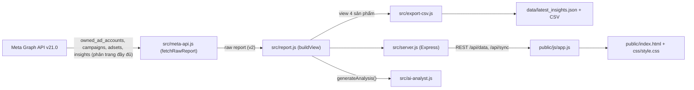

# PROJECT CONTEXT — Meta Ads Analytics (BM Ucmas Việt Nam)

> **Tài liệu bối cảnh dành cho AI / Developer tiếp theo.**
> Đọc file này TRƯỚC khi sửa bất kỳ dòng code nào. Quy tắc làm việc bắt buộc nằm ở
> [`.agents/rules/quy-tac-du-an.md`](./.agents/rules/quy-tac-du-an.md).
>
> Cập nhật lần cuối: 2026-10-15

---

## 1. Mục tiêu ứng dụng

Ứng dụng web **chạy local** (Node.js + Express + HTML/CSS/JS thuần) giúp chủ doanh nghiệp:

1. Kéo dữ liệu quảng cáo **thật** từ Meta Marketing API (Graph API) cho **toàn bộ tài khoản quảng cáo thuộc 1 Business Manager duy nhất**.
2. Xem báo cáo theo **2 chiều**: theo **Tài khoản quảng cáo** và theo **Sản phẩm**.
3. Theo dõi **ngân sách dự kiến chi tiêu trong ngày** (CBO + ABO) và tiến độ giải ngân hôm nay.
4. Nhận chẩn đoán / khuyến nghị tự động (rule-based, không gọi LLM) cho từng chiến dịch.
5. Xuất dữ liệu ra CSV / JSON chuẩn UTF-8.

Mô hình kinh doanh: **giáo dục (toán tư duy cho trẻ em)**. Chuyển đổi chính là **tin nhắn (messaging)** / lead, **KHÔNG phải mua hàng online**. Vì vậy CPA (giá/tin nhắn) là chỉ số quan trọng nhất; Doanh thu & ROAS thương mại điện tử không áp dụng.

---

## 2. Ràng buộc nghiệp vụ CỐ ĐỊNH (không được tự ý thay đổi)

| # | Ràng buộc | Giá trị |
|---|-----------|---------|
| 1 | Business Manager duy nhất | **BM ID `2590933284556026`** ("Ucmas Việt Nam") — 10 tài khoản quảng cáo owned |
| 2 | Meta App | App ID `1512128683054595` ("APP Test") |
| 3 | Sản phẩm được hiển thị & phân tích | **Chỉ 4 sản phẩm: UCMAS, UCKID, MATHCA, TRẠI HÈ** |
| 4 | Quy tắc nhận diện sản phẩm | Lấy đoạn text **giữa dấu `/` thứ 1 và thứ 2** trong tên chiến dịch. VD: `hai/ucmas/mess/khaigiang` → `ucmas` |
| 5 | Sản phẩm khác | Gán key `khac`, **không hiển thị** trong 4 thẻ sản phẩm và bộ lọc "Tất cả 4 sản phẩm" |
| 6 | Tiền tệ | VND, timezone `Asia/Ho_Chi_Minh` |

### 2.1 Bảng ánh xạ sản phẩm (`detectProduct()` trong `src/meta-api.js`)

| Đoạn giữa `/…/` (không phân biệt hoa thường) | key | Nhãn |
|---|---|---|
| chứa `ucmas` (gồm `ucmass`) | `ucmas` | UCMAS |
| chứa `uckid` hoặc bằng `uc-kid` | `uckid` | UCKID |
| chứa `mathca` (gồm `somathca`) | `mathca` | MATHCA |
| chứa `traihe` hoặc `trại hè` | `traihe` | TRẠI HÈ |
| còn lại | `khac` | Khác |

Fallback: nếu tên không có đủ dấu `/`, tìm từ khoá trong toàn bộ tên.

### 2.2 Công thức Ngân sách dự kiến hôm nay (`expectedDailyBudget`)

Phần lớn chiến dịch trong BM chạy **ABO** (ngân sách đặt ở Nhóm quảng cáo), nên `campaign.daily_budget` thường = 0.

```
Nếu chiến dịch đang chạy:
    Nếu campaign.daily_budget > 0  (CBO) → dùng campaign.daily_budget
    Ngược lại (ABO)                      → Σ adset.daily_budget của các adset có effective_status === 'ACTIVE'
Nếu chiến dịch không chạy → 0
```

⚠️ **Bắt buộc dùng `effective_status === 'ACTIVE'`** cho adset (không dùng `status`). Adset có `status: ACTIVE` nhưng chiến dịch cha bị tắt sẽ có `effective_status: CAMPAIGN_PAUSED` và KHÔNG tiêu tiền.

Tổng hợp lên: chiến dịch → sản phẩm (`products[i].expectedDailyBudget`) → toàn bộ (`summary.expectedDailyBudget`).

### 2.3 Chỉ số chuyển đổi chính (`extractMessages()`)

Ưu tiên theo thứ tự: `onsite_conversion.messaging_conversation_started_7d` → `onsite_conversion.total_messaging_connection` → `lead` → `purchase`. Giá trị này được lưu vào trường `messages` (số tin nhắn / lead).

---

## 3. Kiến trúc & luồng dữ liệu



1. Server khởi động → đọc `data/latest_insights.json` (nếu có version: 2) vào bộ nhớ (`rawReport`).
2. Người dùng bấm **Đồng bộ** → `POST /api/sync` → `fetchRawReport()` gọi Meta API duyệt hết `paging.next` cho 10 tài khoản → ghi lại file JSON/CSV → trả payload view + phân tích AI.
3. Lọc theo **sản phẩm** được xử lý tức thì qua `GET /api/data?product=...` do server `buildView()` tính toán chính xác số liệu tổng hợp.
4. Lọc theo **tài khoản** / **khoảng thời gian** → gọi lại `/api/sync`.

---

## 4. Cấu trúc thư mục

```text
Local_phantich_ads/
├── .agents/
│   ├── rules/quy-tac-du-an.md        # QUY TẮC BẮT BUỘC cho AI (always_on)
│   └── plugins/meta-ads/             # Plugin Antigravity: MCP server + skill meta-ads
│       ├── plugin.json
│       ├── mcp_config.json           # Trỏ tới mcp-launcher.js
│       └── skills/meta-ads/SKILL.md
├── backup_2026-10-15/                # Bản sao lưu an toàn trước khi tối ưu
├── data/                             # Dữ liệu sinh tự động (gitignored)
│   ├── latest_insights.json          # Snapshot raw report v2
│   ├── campaigns.csv                 # Excel UTF-8 BOM
│   └── daily_performance.csv
├── public/                           # Frontend tĩnh (served by Express)
│   ├── index.html                    # Layout dashboard chuẩn SEO & responsive
│   ├── css/style.css                 # Design system Dark Glassmorphism dùng CSS variables
│   └── js/app.js                     # Logic UI, Chart.js, bộ lọc & sắp xếp bảng
├── src/
│   ├── config.js                     # Đọc .env & updateEnvFile an toàn
│   ├── meta-api.js                   # Client Graph API với phân trang toàn diện
│   ├── report.js                     # View builder lọc 4 sản phẩm & tổng hợp chỉ số
│   ├── ai-analyst.js                 # Động cơ chẩn đoán rule-based chuẩn CPA tin nhắn
│   ├── export-csv.js                 # Xuất CSV UTF-8 BOM & JSON
│   └── server.js                     # Express server + REST API + OAuth
├── mcp-launcher.js                   # Khởi chạy @mikusnuz/meta-ads-mcp
├── .env                              # BÍ MẬT: token, app secret (gitignored)
├── .env.example                      # Mẫu biến môi trường
├── HUONG_DAN_LAY_TOKEN_META.md       # Hướng dẫn lấy access token
├── PROJECT_CONTEXT.md                # (file này)
└── README.md                         # Hướng dẫn sử dụng cho người dùng
```

---

## 5. Biến môi trường (`.env`)

| Biến | Bắt buộc | Mô tả |
|---|---|---|
| `META_ADS_ACCESS_TOKEN` | ✅ | User/System User token, quyền `ads_read`, `read_insights` |
| `META_AD_ACCOUNT_ID` | ⛔ (dùng cho MCP) | Tài khoản mặc định cho MCP server |
| `META_BUSINESS_ID` | ⛔ | Mặc định `2590933284556026` |
| `META_APP_ID` / `META_APP_SECRET` | ⛔ | Dùng cho OAuth `/auth/login` và đổi token 60 ngày |
| `META_API_VERSION` | ⛔ | Mặc định `v21.0` |
| `PORT` | ⛔ | Mặc định `3000` |

---

## 6. REST API (`src/server.js`)

| Method | Endpoint | Chức năng |
|---|---|---|
| GET | `/api/data?product=...` | Trả về view báo cáo theo sản phẩm (`ALL` hoặc key sản phẩm) + phân tích AI |
| POST | `/api/sync` | Body `{ datePreset, accountId, productFilter }` → kéo dữ liệu mới từ Meta |
| POST | `/api/save-config` | Lưu token/app vào `.env` (chỉ cập nhật đúng key được gửi) |
| GET | `/api/export/:fileType` | `campaigns` \| `daily` \| `json` |
| GET | `/docs/huong-dan-token` | Tải tài liệu hướng dẫn lấy token dạng text UTF-8 |
| GET | `/auth/login`, `/auth/callback` | OAuth Facebook |

`datePreset` hợp lệ: `last_30d`, `last_7d`, `last_14d`, `this_month`, `today`, `yesterday`.

---

## 7. Cấu trúc view báo cáo trả về cho Client

```jsonc
{
  "view": {
    "fetchedAt": "ISO date",
    "datePreset": "last_30d",
    "scope": { "businessId", "accountId", "name", "currency" },
    "bmAccounts": [ { "id", "numericId", "name", "status", "currency" } ],
    "product": "ALL | ucmas | uckid | mathca | traihe",
    "products": [
      { "key", "name", "subtitle", "count", "spend", "messages", "expectedDailyBudget", "todaySpend", "todayMessages", "cpa", "ctr", "cpc", "pacingPct" }
    ],
    "summary": {
      "totalSpend", "totalMessages", "avgCpa", "expectedDailyBudget", "todaySpend", "todayMessages", "todayCpa", "pacingPct", "campaignCount", "activeCount"
    },
    "funnel": { "impressions", "clicks", "messages" },
    "dailyTrend": [ { "date", "spend", "messages", "cpa", ... } ],
    "placements": [ { "platform", "label", "spend", "percentage" } ],
    "campaigns": [
      { "id", "name", "accountId", "accountName", "product", "productLabel", "effective_status", "expectedDailyBudget", "spend", "messages", "cpa", "todaySpend", "todayMessages", "ctr", "recommendation" }
    ]
  },
  "analysis": {
    "healthScore": 66,
    "statusLabel": "Hoạt động trung bình",
    "statusLevel": "warn",
    "recommendations": [ { "type", "title", "message" } ],
    "topPerformers": [ ... ],
    "moneyWasters": [ ... ],
    "fatigueAlerts": [ ... ],
    "executiveSummary": "..."
  }
}
```

---

## 8. Ngưỡng nghiệp vụ phân tích AI (`src/ai-analyst.js`)

| Chỉ số | Ngưỡng |
|---|---|
| CPA tốt / trung bình / cao | ≤ 65.000 ₫ / ≤ 90.000 ₫ / > 90.000 ₫ |
| Win cần scale | ≥ 10 tin & CPA ≤ 65.000 ₫ (đang chạy) |
| Cần rà soát (Money Waster) | Chi > 1,2tr & 0 tin, hoặc chi > 2tr & CPA > 130.000 ₫ (đang chạy) |
| Fatigue | Frequency ≥ 3.0 (đang chạy) |
| CTR thấp / cao | < 1,2% / ≥ 2,0% |

---

## 9. Vấn đề đã biết (Known Issues) — cập nhật khi sửa xong

> Đã hoàn tất rà soát & tối ưu ngày 2026-10-15:
1. ✅ **Phân trang (pagination) Graph API**: Đã thêm `callGraphApiAll()` duyệt toàn bộ `paging.next` cho `campaigns`, `adsets`, `insights`. Số chiến dịch quét tăng từ 479 lên 618 (TK 1: 224 chiến dịch, TK 6: 115 chiến dịch).
2. ✅ **Xoá bỏ hoàn toàn dữ liệu giả lập**: Gỡ bỏ các tỷ lệ phễu giả, placement cố định, và frequency 2.3. Thay bằng dữ liệu thật: breakdown `publisher_platform`, phễu 3 tầng thực tế (Hiển thị → Click → Tin nhắn), và frequency thật.
3. ✅ **Sửa cấu trúc HTML header**: Đã thêm thẻ `<div class="header-right">`, giao diện co giãn chuẩn.
4. ✅ **Bảo vệ an toàn file `.env`**: Thay thế bằng hàm `updateEnvFile()` chỉ cập nhật đúng key được gửi lên, không xoá biến khác.
5. ✅ **Sửa đường dẫn tài liệu Token**: Link footer trỏ tới `/docs/huong-dan-token` tải file trực tiếp, không bị 404.
6. ✅ **Tối ưu Payload & Tốc độ**: Tách `fetchRawReport` và `buildView` tại server. Bỏ trùng lặp `allCampaigns`, JSON nén gọn, đồng bộ 10 tài khoản chỉ mất ~9.6 giây.
7. ✅ **Lọc trạng thái chuẩn xác**: Toàn bộ hệ thống (`ai-analyst.js`, `app.js`, `meta-api.js`) dùng đồng nhất `effective_status === 'ACTIVE'`.
8. ✅ **Bỏ hardcode tài khoản & BM ID**: Đọc động từ `config.businessId` và `bmAccounts.length`.
9. ✅ **Nâng cấp Kiến trúc Local Data Lake (Offline-First)**: Lưu trữ dữ liệu hạt lựu `dailyRecords` và `placementRecords` theo từng ngày của toàn bộ 10 tài khoản. Thao tác đổi tài khoản, đổi khoảng thời gian (Hôm nay, Hôm qua, 7 ngày, 14 ngày, 30 ngày, Tháng này) và đổi 4 sản phẩm chạy 100% Local trong < 2ms, không gọi Meta API. Chỉ gọi Graph API duy nhất khi bấm nút "Đồng bộ Meta Ads".
10. ✅ **Tích hợp Google Sheet CRM & Phễu Tuyển Sinh L1-L4 & 5 Tab Sản Phẩm**: Tự động kéo 1.137 lead từ Google Sheet qua link CSV xuất bản web khi bấm Đồng bộ. Phân rã tiến trình tuyển sinh L1 (SĐT), L2 (tiếp cận), L3 (hẹn test), L4 (nhập học chốt), doanh thu học phí thực tế. Tách giao diện thành 5 Tab điều hướng độc lập: Tổng quan (Toàn BM), UCMAS, UCKID, MATHCA, TRẠI HÈ.

---

## 10. Lịch sử thay đổi quan trọng

| Ngày | Thay đổi |
|---|---|
| 2026-10-15 | Kết nối Meta API với token user "Minh Hải", App `1512128683054595` |
| 2026-10-15 | Giới hạn phạm vi BM `2590933284556026` (10 tài khoản) |
| 2026-10-15 | Phân loại sản phẩm theo quy tắc `/…/`; chốt chỉ 4 SP: UCMAS, UCKID, MATHCA, TRẠI HÈ |
| 2026-10-15 | Thêm Ngân sách dự kiến hôm nay (CBO + ABO, lọc `effective_status`) vào KPI, thẻ SP, bảng |
| 2026-10-15 | Tạo `PROJECT_CONTEXT.md` và `.agents/rules/quy-tac-du-an.md` |
| 2026-10-15 | **Tối ưu toàn diện hệ thống (Đã duyệt)**: Phân trang API (quét đủ 618 CĐ), xoá demo/fake data, thay thế KPI e-commerce bằng tin nhắn/pacing thực tế, đồng nhất UI/UX Dark Glassmorphism, chuẩn hoá schema v2. |
| 2026-10-15 | **Nâng cấp Local Data Lake (Offline-First - Đã duyệt)**: Tách triệt để lớp lưu trữ hạt lựu (`dailyRecords`, `placementRecords`) và lớp biểu diễn (`buildView`). Chuyển toàn bộ lọc tài khoản / ngày / sản phẩm sang xử lý local tức thì (< 2ms), chống Rate Limit Meta, trải nghiệm mượt mà tuyệt đối. |
| 2026-10-15 | **Tích hợp Google Sheet & 5 Tab Chuyên Sâu (Đã duyệt)**: Xây dựng module `src/google-sheet.js`, đo lường phễu tuyển sinh 6 tầng L1-L4, ghi nhận doanh thu học phí & CAC thực tế, chia 5 tab chuyên sâu cho từng sản phẩm. |

